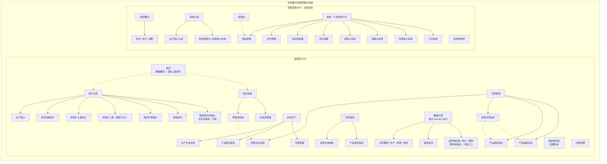
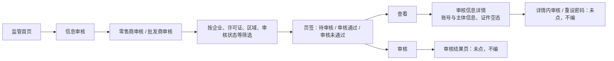
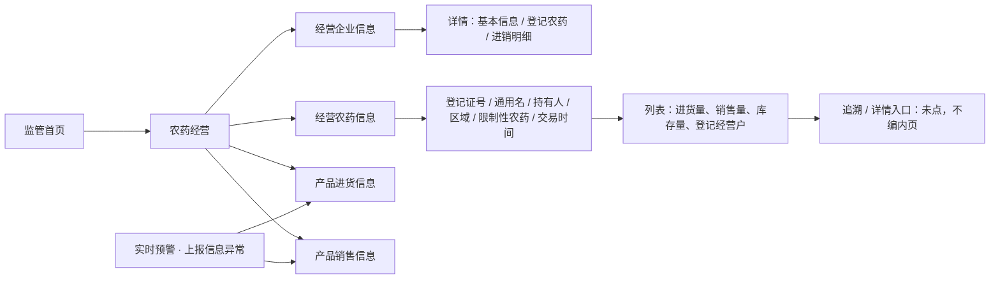
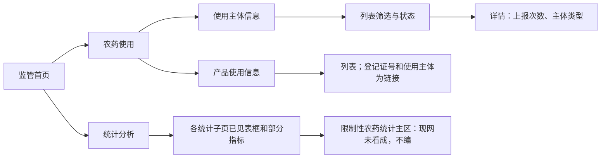
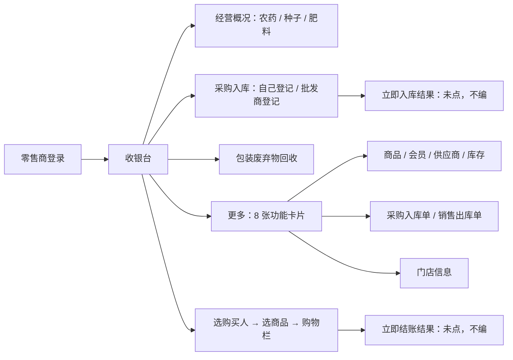
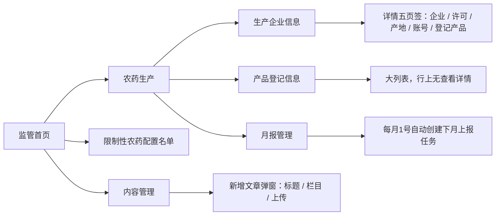

# 农药数字监督管理 · 功能架构与流程（现网基线）

主基线：一比一跟现网。本文只画已观察结构；现网未看成或未执行的节点标 **未知 / 不编**。范围核对和补齐项只对照招标文件，可研与标书不一致处以标书为准，可研不作为输入。招标中有、现网菜单没有的单列 **招标补齐项**，不并入主架构、不进主菜单。  
对照目录：`合并原型1.0-农药一比一`。细目以同目录 `pes-监管端观察记录.md`、`pes-零售端观察记录.md` 和 `pes-已观察与缺口清单.md` 为准（2026-11-20 已只读补观察）。监管端与零售商端都要做完整页（字段、筛选、只读详情），写操作结果页不编。

---

## 1. 功能架构

### 1.1 监管端一级菜单（现网侧栏顺序）

1. 首页 `#/home`：安徽省数据概览（左农药经营 / 右农药使用）+ 全省上报排行
2. 数据大屏：侧栏入口，实际新开独立站点 `http://ahny.ahlssp.net:81/screen/`（标题「安徽省农药智慧数据管理大屏」），不要嵌在监管壳里
3. 信息审核：零售商审核、批发商审核（同一套界面，`type=1/2`）
4. 统计分析：生产统计；经营统计分组下有农药交易统计、经营户上报统计、经营户上报（国家平台）、施用作物统计；使用统计；限制性农药统计（菜单和路由已见，主区未看成，不编内页）
5. 农药生产：生产企业信息、产品登记信息、月报管理
6. 农药经营：经营企业信息、经营农药信息、产品进货信息、产品销售信息
7. 农药使用：使用主体信息、产品使用信息
8. 限制性农药（一级）→ `#/basicSetup/basicSetup`，这是配置名单，**不是**统计分析下的「限制性农药统计」
9. 内容管理（一级）→ `#/contentManagement/contentManagement`

顶栏（壳内功能）：实时预警、月报、技术支持、用户区。页脚已见「技术支持：信联信息发展股份有限公司 服务热线：400-7200100」。

### 1.2 结构图

对象关系（详情已进部分，口径仍未做规则确认）：

- 经营企业 ↔ 审核记录（零售商 / 批发商同一套审核界面和详情）
- 经营企业详情可见登记农药、进货明细、销售明细
- 农药登记 ↔ 进货 / 销售 / 库存（经营农药列表同屏可见）
- 产品使用信息中，登记证号、使用主体是链接
- 使用主体详情可见上报次数、主体类型（企业 / 种植户）
- 经营户上报统计 ↔ 经营企业上报记录：推断，口径未知

角色与组织：登录后仍未显示，权限结论为 **未知**。监管端深蓝侧栏 + 农绿，零售端亮绿顶栏，两套皮肤不要混用。

---

## 2. 核心流程（只读已观察）

### 2.1 经营企业审核

待办行是「查看」（青色）和「审核」（橙色）两个按钮，不是「查看审核」。「新用户」与「信息修改」两类详情布局相同；批发商详情未见「平台名称」。列表可导出，未执行，结果不编。

### 2.2 经营农药与进销存查阅

进货 / 销售无筛选时可能长时间「正在加载」。列表列以预警下钻后已加载成功的视图为准，不要编未出现的列。经营企业页有零售/批发切换、已上报芯片、「限制性农药销售」开关文案；「开启」、导出、审核/重设密码/锁定账号均不编结果。

### 2.3 使用主体、产品使用与统计

统计各页可落已见指标、图表位和空态；导出未执行。指标口径与时间窗口仍未确认，数值用演示或「—」。

### 2.4 零售商端（主页面已观察）

收银台可先按已观察控件搭完整页。结账、入库提交、改价、补库存、退货、导出、门店变更等结果只留入口。登录页本轮未单独对照。

### 2.5 生产、限制性农药配置与内容管理

添加生产企业、停用、编辑、手动添加上报任务、导入/编辑/删除限制性农药、保存并发布、删除文章均未执行，结果不编。内容管理所属栏目目前只确认到「通知和公告」；上传限制为指定办公文档后缀且不超过 8M。

### 2.6 数据大屏与顶栏

数据大屏独立打开，可落概览、生产、经营、使用、监管执法的已见指标和画面；废弃物回收（现网 500）、种子监管（空白画布）、肥料监管只留入口。

实时预警三项：上报信息异常（可下钻进货/销售预警列表）、备案信息异常（零售进经营企业过滤视图；批发主体现网 500，不编）、经营许可证过期（弹窗标题实为「营业执照异常」，大列表未下钻，不编）。月报是页内「N月度数据报告」。技术支持是微信扫码气泡。

---

## 3. 招标补齐项（不进入本次主菜单）

现网主菜单没有、或本轮仍未看成独立页面、招标基线里有的，先登记，不画进侧栏：

| 项 | 说明 | 处理 |
|---|---|---|
| 生产 / 经营 / 使用分端填报 | 招标是三端填报、监管端看汇总 | 零售端已见经营侧收银台、入库、出库等，未见独立的生产端 / 使用端填报系统，不另开主菜单 |
| 流向追溯 | 招标要求监管可追溯 | 经营农药信息有追溯入口，内页未点；不单列为一级菜单 |
| 包装废弃物回收 | 零售端已有完整页；监管端大屏有「废弃物回收」分页 | 零售端按观察记录落；大屏该页现网 500，只留入口 |
| 公众服务 / 3D 驾驶舱 | 旧原型有，现网侧栏未出现 | 不进入主架构 |

---

## 4. 给原型的使用约定

- @老三 按两份观察记录和缺口清单第 1、2.1 节及零售端已观察表，落完整交互。第 2.2 节现网故障页（限制性农药统计主区、大屏废弃物/种子/肥料、备案异常批发主体）只留入口。写操作结果一律不编。限制性农药配置与限制性农药统计不要并成一项；数据大屏走独立 `/screen/`，不要嵌在壳里；审核待办行用「查看」「审核」两个按钮。
- @留白 跟视觉壳和配色。监管端与零售端皮肤分开；若现网那几个故障子页后来能打开，再只读补一版。
- 登录页本轮未再对照全屏登录，仍按视觉规范收，不要把现网个人信息写进原型。
