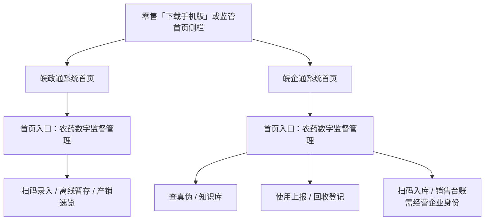

# 农药数字监督管理分系统 · 原型功能说明（演示用）

编制日期：2026-11-20（Asia/Shanghai）  
修订日期：2026-11-21（Asia/Shanghai），按最新挂菜、演示弹窗和移动端首页重写  
对照目录：`合并原型1.0-农药一比一`  
预览根地址：[http://localhost:5274/anhuiliangshi/](http://localhost:5274/anhuiliangshi/)

本文按走流程写，方便对着原型讲解：先说每块是干什么的，再给一条推荐主路径和流程图。只写当前已经能点到的页面；现网还没看成的内页不编进讲词。

---

## 0. 开场先说清的五件事

1. **这套原型有两层。** 监管端、零售端的一级菜单仍是按现网一比一做的。标书里现网没有的能力，已经挂到对应菜单下面，菜单名后有浅金小标「招标补齐」，不要讲成现网本来就有。生产填报端现网没有，仍是单独入口，没有塞进监管侧栏。侧栏底部不再单列「招标补齐」整组。
2. **账号、密码、验证码任意填写即可。** 监管、零售、生产三个登录页都是这样。
3. **演示闭环批次是 `YS20261120A`。** 对应演示数据：演示生产企业甲 → 演示经营企业甲 → 演示购买人丙，产品是「演示农药甲」。地名和数量都是演示数据，不对应真实县区和产量。
4. **写操作是演示态。** 提交、入库、结账、同步成功只写在原型里，不会回写现网。演示会点到的写操作弹窗都能打开，标题后有浅暖底小标「演示补齐」，标明是后补的，不是现网一比一弹窗。不要讲成已在现网办结。
5. **原系统的农资台账一体机已经取消。** 那些能力转到了皖政通和皖企通。零售顶栏不再保留一体机宣传条；点「下载手机版」会说明这一迁移，并先进入两个系统的首页。不要讲成「现网顶栏本来就没有这条」。

---

## 1. 各端是干什么的

### 1.1 生产填报端（招标补齐，现网没有这个端）

入口：[生产填报登录](http://localhost:5274/anhuiliangshi/#/pes/producer/login)  
标题是「农药生产电子台账填报」，对应标书评标演示「生产企业网页录入」。

| 页面 | 路径 | 干什么 |
|---|---|---|
| 企业备案 | `#/pes/producer/profile` | 确认演示生产企业档案。未确认时不能填批次；点「确认备案信息」后即可填报。 |
| 产品登记 | `#/pes/producer/products` | 查看或新增农药名称、登记证号、商标、类别、剂型、规格、是否限制性农药。预置了「演示农药甲」。 |
| 生产批次与台账 | `#/pes/producer/ledger` | 录入生产日期、批次号、产量、销量、库存、销售去向并提交。提交成功后，监管端追溯和零售端扫码入库都能看到这一批。预置批次就是 `YS20261120A`。 |

顶栏是亮绿色，和零售端同一套皮肤，不要和监管端深蓝侧栏搞混。

### 1.2 零售经营端（现网有，写操作做成了演示闭环）

入口：[零售端登录](http://localhost:5274/anhuiliangshi/#/pes/retail/login)，登录后进收银台。

| 页面 | 路径 | 干什么 |
|---|---|---|
| 收银台 | `#/pes/retail/cashier` | 选择购买人（可散客或演示购买人丙），扫码或选商品加入购物车，点「立即结账」。对应出库到购买人。 |
| 采购入库 | 顶栏「采购入库」 | 选「自己登记入库」，用「扫码录入」识别批次后点「立即入库」。演示环境用批次号代替真实扫码，默认就是 `YS20261120A`。未先在生产端提交的批次会提示识别不到。 |
| 废弃物回收 | 顶栏「废弃物回收」 | 门店侧登记包装废弃物交回。 |
| 经营概况 / 更多 | 顶栏对应入口 | 现网已有的门店经营查阅和 8 张功能卡片（商品、会员、供应商、库存、入出库单、门店信息等）。 |
| 下载手机版 | 顶栏按钮 | 说明一体机功能已迁至皖政通、皖企通，分别进入 [皖政通系统首页](http://localhost:5274/anhuiliangshi/#/mobile/wanzhengtong)、[皖企通系统首页](http://localhost:5274/anhuiliangshi/#/mobile/wanqitong)，再从首页进农药功能。 |

注意顺序：要先入库，再扫码销售。未入库就结账，会提示「该批次尚未入库」。

### 1.3 监管端菜单（现网项 + 挂在下面的招标补齐项）

入口：[监管端登录](http://localhost:5274/anhuiliangshi/#/pes/login)

带「招标补齐」小标的，是后挂进去的，讲解时点明即可。

| 菜单 | 干什么 |
|---|---|
| 首页 | 安徽省数据概览：农药经营 / 农药使用，以及全省上报排行。同一组下挂了「互联互通演示」「皖政通」「皖企通」（均招标补齐）。后两个入口先到对应系统首页，不要直接跳进某个功能页。 |
| 数据大屏 | 「数据大屏」仍独立打开「安徽省农药智慧数据管理大屏」，看生产、经营、使用、监管执法等总览。同一组下挂了「3D 监管驾驶舱」「农药监管一张图」（均招标补齐）。种子监管、肥料监管现网打不开，只留入口，不要展开讲。大屏废弃物分页用的是演示数据，现网原页当时打不开，不要讲成现网故障页已经修好。 |
| 信息审核 | 零售商审核、批发商审核。待办行是「查看」和「审核」两个按钮。审核弹窗带「演示补齐」小标，不要讲成已在现网办结。 |
| 统计分析 | 生产、交易、经营户上报、国家平台上报、施用作物、使用、限制性农药统计。 |
| 农药生产 | 查阅生产企业信息、产品登记信息、月报管理。这是监管看数，不是企业填报。同一组下挂了「产品与批次库」（招标补齐），是批次主数据，和生产填报、追溯共用一套演示数据。 |
| 农药经营 | 查阅经营企业、经营农药、产品进货、产品销售。主路径入库出库后，可回到进货 / 销售列表按批次对上。同一组下挂了「流向追溯」「包装废弃物回收」（均招标补齐）。流向追溯按批次看生产企业 → 经营网点 → 购买人（以及使用、回收）；监管侧回收是归集凭证、批次、站点、交回主体、处置方式，和零售端门店回收不是同一页。 |
| 农药使用 | 查阅使用主体、产品使用信息。 |
| 限制性农药 | 配置名单，不要和统计分析里的「限制性农药统计」讲成同一页。 |
| 内容管理 | 通知公告等内容维护。 |
| 顶栏「您好」 | 账户分级与角色切换（招标补齐，不再单占侧栏菜单）。演示身份：省级 / 市级 / 县级监管、生产企业、经营企业、回收主体。现网一级菜单不随角色增删。切到生产企业会进填报端，切到经营企业会进零售收银台。也可打开 [`#/pes/roles`](http://localhost:5274/anhuiliangshi/#/pes/roles)。 |

关键补齐页路径，方便直接打开：

| 页面 | 路径 |
|---|---|
| 互联互通演示 | [ `#/pes/interconnect` ](http://localhost:5274/anhuiliangshi/#/pes/interconnect) |
| 产品与批次库 | [ `#/pes/products` ](http://localhost:5274/anhuiliangshi/#/pes/products) |
| 流向追溯 | [ `#/pes/trace` ](http://localhost:5274/anhuiliangshi/#/pes/trace) |
| 包装废弃物回收（监管侧） | [ `#/pes/recycle` ](http://localhost:5274/anhuiliangshi/#/pes/recycle) |
| 3D 监管驾驶舱 | [ `#/pes/cockpit` ](http://localhost:5274/anhuiliangshi/#/pes/cockpit) |
| 农药监管一张图 | [ `#/pes/onemap` ](http://localhost:5274/anhuiliangshi/#/pes/onemap) |
| 皖政通系统首页 | [ `#/mobile/wanzhengtong` ](http://localhost:5274/anhuiliangshi/#/mobile/wanzhengtong) |
| 皖企通系统首页 | [ `#/mobile/wanqitong` ](http://localhost:5274/anhuiliangshi/#/mobile/wanqitong) |

互联互通页展示对接对象、同步任务、调用 / 抓取日志。可点「执行一次演示同步」，会写入一条关于 `YS20261120A` 的成功日志。页上已写明：不是真实接口，也不假装已经迁完。日志里有一条对国家平台「接口超时」的失败示例，可顺带说明异常可重试。

现网还没看成的内页（如登记经营户内页、限制性农药统计「查看明细」、部分施用作物内页）不要即兴编字段。

### 1.4 移动端（先到系统首页，再进功能页）

不要一进来就停留在某个农药功能页。入口有三处：零售「下载手机版」、监管首页下的「皖政通 / 皖企通」、以及下面的系统首页链接。

**皖政通**

1. 先到 [皖政通系统首页](http://localhost:5274/anhuiliangshi/#/mobile/wanzhengtong)。
2. 点首页「农药数字监督管理」，进入农药录入页 [`#/mobile/wzt-pesticide`](http://localhost:5274/anhuiliangshi/#/mobile/wzt-pesticide)。
3. 用批次号代替扫码，录入生产 / 销售；可先「离线暂存」，再「提交并同步」；「产销速览」看关键信息。数据与 PC 端共用。功能页返回回到系统首页。

**皖企通**

1. 先到 [皖企通系统首页](http://localhost:5274/anhuiliangshi/#/mobile/wanqitong)（标题是「皖企通」；粮食、青贮、粮安入口保持原样）。
2. 点首页「农药数字监督管理」，进入农药服务页 [`#/pes/mobile`](http://localhost:5274/anhuiliangshi/#/pes/mobile)。
3. 面向农户和公众：扫码查真伪 / 登记信息，以及用药知识库。右上角切换身份后：使用主体可使用上报，回收主体可回收登记，经营企业可扫码入库和查看 / 登记销售台账（原一体机能力迁到这里，批次仍用 `YS20261120A`）。未入库不能销售。功能页返回回到系统首页。

---

## 2. 推荐演示主路径（对着点）

建议按这个顺序走，对应标书评标里农药的三个点：生产电子台账、经营电子台账（含扫码录入）、与现有系统互联互通。一张图和移动端穿插在追溯之后讲。演示批次始终用 `YS20261120A`，也可以在生产端再新增一批继续走同样流程。

### 第一步：生产电子台账

1. 打开 [生产填报登录](http://localhost:5274/anhuiliangshi/#/pes/producer/login)，任意账号登录。
2. 进「企业备案」，如显示「待确认」，点「确认备案信息」，再点「去填报生产台账」。
3. 可先到「产品登记」看「演示农药甲」（登记证号、商标等），不必每次新加。
4. 在「生产批次与台账」先指给评委看预置批次 `YS20261120A`（产量、库存、销售去向已有数）。若要现场录一笔：点「新增生产批次」，填生产日期、批次号、产量、库存、销售去向（默认去向是演示经营企业甲），点「提交」，弹出「提交成功」。
5. 说明：这是生产企业网页填报，不是监管端代填。

### 第二步：经营入库、出库和扫码

1. 打开 [零售端登录](http://localhost:5274/anhuiliangshi/#/pes/retail/login)，进收银台后切到「采购入库」。
2. 选「自己登记入库」，点「扫码录入」。演示环境用批次号代替扫码，默认就是 `YS20261120A`，点「识别入库」，再点「立即入库」，看到「入库成功」。
3. 回到收银台，点「选择购买人」（选演示购买人丙，或点散客结账），再点「扫码销售」，识别同一批次加入购物车，点「立即结账」，看到「结账成功」。
4. 说明：入库对应采购来源 / 品种 / 数量，出库精确到购买人。

### 第三步：监管端按批次全程追溯，并上图

1. 打开 [监管端登录](http://localhost:5274/anhuiliangshi/#/pes/login)。
2. 可先到现网菜单「农药经营 → 产品进货信息 / 产品销售信息」，对一下刚才那一笔。
3. 仍在「农药经营」下打开 [流向追溯](http://localhost:5274/anhuiliangshi/#/pes/trace)（带「招标补齐」小标），选择 `YS20261120A`，沿链路讲：演示生产企业甲 → 演示经营企业甲 → 演示购买人丙。
4. 到「数据大屏」一组，打开 [农药监管一张图](http://localhost:5274/anhuiliangshi/#/pes/onemap)，用「演示省 / 演示市A / 演示区县A」下钻，开关生产企业 / 经营网点等图层，点点位或「演示闭环批次」路径，再跳回追溯。
5. 打开 [3D 监管驾驶舱](http://localhost:5274/anhuiliangshi/#/pes/cockpit)，看总览指标，点「查看流向追溯」。

### 第四步：包装废弃物

1. 零售端「废弃物回收」登记一笔，或直接打开监管侧「农药经营」下的 [包装废弃物回收](http://localhost:5274/anhuiliangshi/#/pes/recycle) 看归集。
2. 如需看大屏，打开 [大屏废弃物回收](http://localhost:5274/anhuiliangshi/#/screen/recycle)，并说明这是演示数据，现网原页当时无法打开。

### 第五步：移动端（先首页，再功能）

1. 从零售「下载手机版」，或监管首页下的「皖政通 / 皖企通」，先进入系统首页，不要直接打开功能页开讲。
2. 在 [皖政通首页](http://localhost:5274/anhuiliangshi/#/mobile/wanzhengtong) 点「农药数字监督管理」：在「扫码录入」里用批次号录一笔，可先「离线暂存」，再「提交并同步」，到「产销速览」看结果。
3. 在 [皖企通首页](http://localhost:5274/anhuiliangshi/#/mobile/wanqitong) 点「农药数字监督管理」：演示「扫一扫 · 查真伪」和「知识库」。若要讲使用上报、回收登记，或经营侧扫码入库 / 销售台账，先点右上角切换身份。

### 第六步：互联互通和账户分级

1. 回到监管端「首页」一组，打开 [互联互通演示](http://localhost:5274/anhuiliangshi/#/pes/interconnect)。先讲对接对象（现有农药数字监督管理平台、国家平台等），再点「执行一次演示同步」，日志里会出现该批次的回传记录。明确说：这是演示同步，不是现场真实调通。
2. 用监管端右上角「您好」下拉切换省 / 市 / 县，看同一套现网菜单；切到生产企业、经营企业分别进入填报端和零售端。说明这是演示级分级账号，不要讲成已对接皖政通 / 统一身份。

---

## 3. 和标书演示点的对应

| 标书评标要求 | 在原型里怎么讲 | 走哪 |
|---|---|---|
| 农药生产电子台账：备案、产品登记、生产批次（日期、批次号、数量），记录产量、库存、销售去向 | 生产填报端三条菜单就是这组字段 | 第一步 |
| 农药经营电子台账：入库（采购来源、品种、数量）、出库（销售对象、数量、时间），扫码快速录入 | 零售端扫码入库 + 扫码销售结账；也可在皖企通经营企业身份下演示扫码入库和销售台账 | 第二步、第五步 |
| 与现有系统互联互通：数据抓取、调用或共享同步 | 首页下「互联互通演示」的对接对象、任务、成功 / 失败日志，以及一次演示同步 | 第六步 |
| 建设清单中的一张图 / 3D、使用主体、包装废弃物、移动端 | 数据大屏一组里的一张图和驾驶舱、农药经营下的监管侧回收、先到系统首页再进皖政通 / 皖企通 | 第三、四、五步 |

建设清单里的「管理账户体系集成」只做到演示身份切换，不要讲成已对接皖政通 / 统一身份。历史数据迁移同样只在互联互通页讲述关系，不要讲成已经迁完。

「互联网经营备案」当前没有单独做成一页，演示时不要作为已有模块展开。现网未看成的内页也不要现场发挥。

---

## 4. 演示时的常用提示

- 三个登录页、任意账号即可；走主路径时按「生产 → 零售 → 监管」换端，不要只在监管端讲填报。
- 批次号记一个就够：`YS20261120A`。新录的批次，以提交成功弹窗里的批次号为准，后面扫码和追溯都用它。
- 侧栏里带浅金「招标补齐」小标的，和弹窗标题后带浅暖底「演示补齐」小标的，都要说明是后补的。
- 刷新预览即可看到最新页面。若页面还是旧的，先强制刷新。
- 预览只覆盖农药分系统这次要讲的能力。第 4 包里的粮食计划、青贮、粮安仍在合并原型里，不是本次农药演示主路径。

---

## 5. 页面与数据备注

按两个口径看：一类是已补演示数据的复刻页，一类是现网当时空态或没看成、演示时不展开。凡是讲到数字和地名，都要说明是演示数据，不对应现网当时的真实县区和产量。

### 5.1 已补演示数据的复刻页

下面这些页原先按现网空态留白，或只有页头指标、明细是空的，现已用演示样例撑起来，方便讲解。

| 页面 | 在哪看 | 备注 |
|---|---|---|
| 监管首页「农药使用」排行 | [监管首页](http://localhost:5274/anhuiliangshi/#/pes/home) | 现网当时使用侧是 0 / 暂无数据，现用演示区县排行补上。经营侧排行此前已有演示数。 |
| 生产统计 | [生产统计](http://localhost:5274/anhuiliangshi/#/pes/stats/production) | 页头指标此前已有演示数；分类下钻明细是后来补的。 |
| 农药交易统计 | [农药交易统计](http://localhost:5274/anhuiliangshi/#/pes/stats/trade) | 页头指标此前已有演示数；「查看明细」后来补了演示行。 |
| 国家平台上报 | [国家平台上报](http://localhost:5274/anhuiliangshi/#/pes/stats/country-report) | 已上报 / 未上报名单用演示经营企业撑起来。现网部分筛选组合当时是空态。 |
| 施用作物统计 | [施用作物统计](http://localhost:5274/anhuiliangshi/#/pes/stats/crops) | 现网当时有列无行，现补了演示作物和销售量。 |
| 使用统计 | [使用统计](http://localhost:5274/anhuiliangshi/#/pes/stats/usage) | 现网当时是 0 / 暂无数据，现补了演示表。 |
| 零售经营概况 | [经营概况](http://localhost:5274/anhuiliangshi/#/pes/retail/businessOverview) | 销售指标、趋势、排行和废弃物回收数均为演示数据。 |
| 待接收入库单 / 已关闭入库单 | [采购入库](http://localhost:5274/anhuiliangshi/#/pes/retail/purchasing) | 现网当时是空态文案，现补了演示批发商单据。 |
| 赊还账记录 | 零售端「会员管理」点进去 | 补了演示购买人丙的赊还账。 |
| 门店信息文字字段 | [门店信息](http://localhost:5274/anhuiliangshi/#/pes/retail/storeInformation) | 成立日期、地址、电话、证照编号等用演示占位补上。证件照片仍空，见 5.2。 |
| 数据大屏概览 / 生产 / 经营 / 使用 | [数据大屏概览](http://localhost:5274/anhuiliangshi/#/screen/overview) | 指标用演示数据。废弃物分页本来就是演示数据。种子、肥料大屏见 5.2。 |

另有一批复刻页此前已经按现网列名落下并填了演示行，不必再当空页讲：监管端的生产企业、产品登记、月报、经营企业、经营农药、进货销售、使用主体、审核列表，以及零售端的商品、会员、供应商、库存、入出库单等。

### 5.2 现网空态或未看成、演示时不展开

- 登记经营户内页：现网没看成，不编字段，不要点进去展开讲。
- 限制性农药统计：主区已有页面壳，但现网主区当时未完整看成；部分指标仍是空的，「查看明细」不要展开讲。
- 门店信息的证件照片：现网当时未上传，仍保留空态。
- 种子监管、肥料监管大屏：现网打不开，只留入口。
- 「互联网经营备案」没有单独做成一页，不要作为已有模块展开。
- 审核、重设密码、修改密码、锁定账号、导出、编辑信息、补充库存等写操作，会打开带「演示补齐」小标的弹窗，只用于演示点得开，不要讲成已在现网办结。
